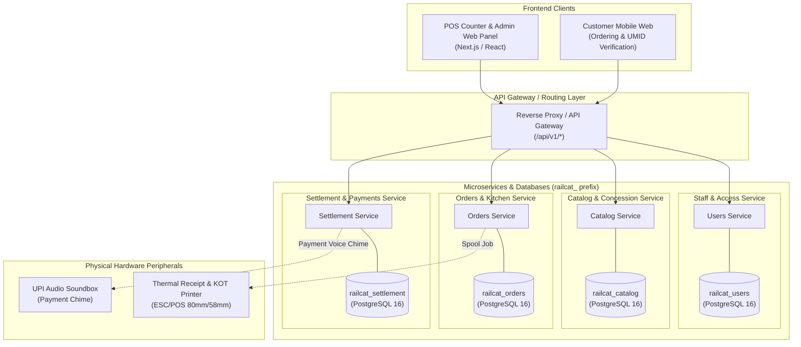

# 01. Architecture Overview — RailCat Private Restaurant Platform

---

## 1. Core Domain Context & Philosophy

**RailCat** is an independent, private commercial restaurant / quick-service curry point (QSR) operating on a commercial contract basis.

### Critical Clarifications:
- **Not an Indian Railways enterprise platform**: Does not manage railway network infrastructure, trains, coaches, berths, PNRs, stations, zones, or divisions.
- **Differential Pricing Business Model**: The *only* railway-related business logic is **Differential Pricing**:
  1. **Retail / Normal Users**: Pay standard menu prices + 5% GST.
  2. **Railway Employees**: Receive a verified concession discount (default 20%) upon validating their Railway Employee ID / UMID and single-device lock.
- **Domain-Driven Design (DDD)**: The system is structured into **4 lean, independently owned databases**, prefixed with `railcat_`:
  1. `railcat_users`: Restaurant staff accounts, roles (`ADMIN`, `COUNTER_OPERATOR`, `KITCHEN_STAFF`), credentials, and active sessions.
  2. `railcat_catalog`: Menu categories, food items, pricing, culinary tags, concession policies, and verified railway employee registry.
  3. `railcat_orders`: POS and self-ordering, atomic daily queue token generation (`A-001`), kitchen KDS status workflow, and thermal print spooling.
  4. `railcat_settlement`: Cashier shift cash drawers, multi-channel payment records (UPI, Cash, Card), and daily sales summaries.

---

## 2. High-Level Architecture Diagram

---

## 3. Database-per-Service Principle

Each service has exclusive ownership over its database. Foreign keys never cross database boundaries. Distributed data references are maintained via stable identifiers (UUIDs or business keys like `employee_id` and `order_id`).

| Database | Service Name | Port | Owner Role | Purpose |
| :--- | :--- | :---: | :--- | :--- |
| `railcat_users` | Staff IAM | 5432 | `railcat_users_user` | Authentication, staff roles, and audit sessions |
| `railcat_catalog` | Catalog & Concession | 5432 | `railcat_catalog_user` | Menu, 20% discount policy, and employee registry |
| `railcat_orders` | Orders & Kitchen KDS | 5432 | `railcat_orders_user` | Cart checkout, daily `A-001` queue numbering, KDS |
| `railcat_settlement` | Payments & Finance | 5432 | `railcat_settlement_user` | Shift cash reconciliations, payment logs, daily revenue |
