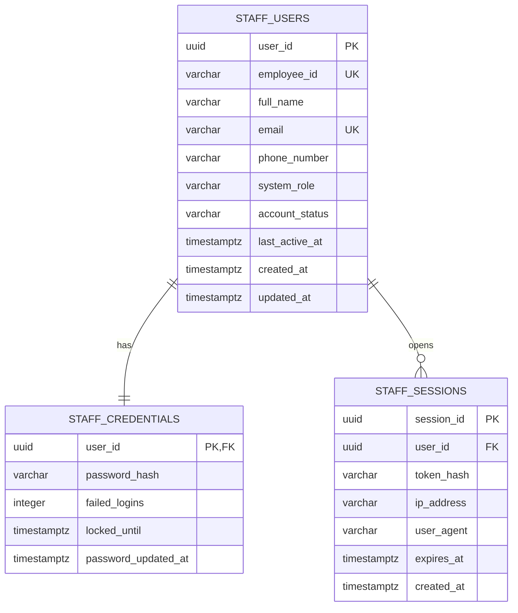
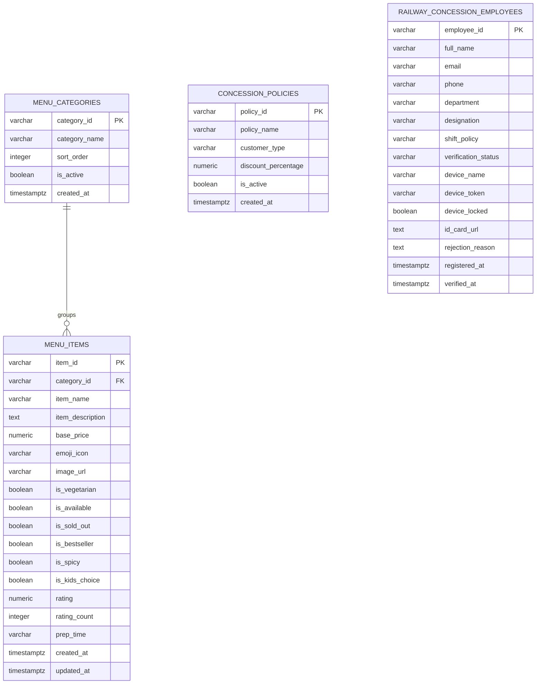
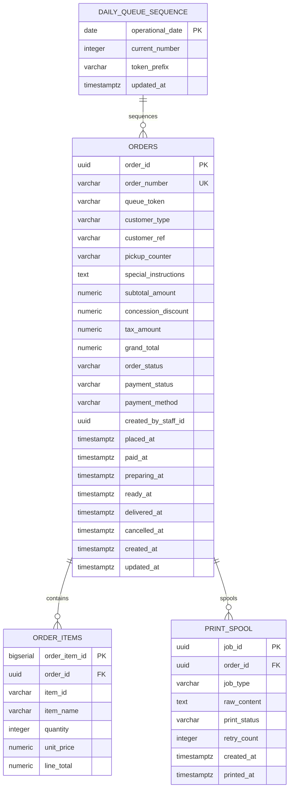
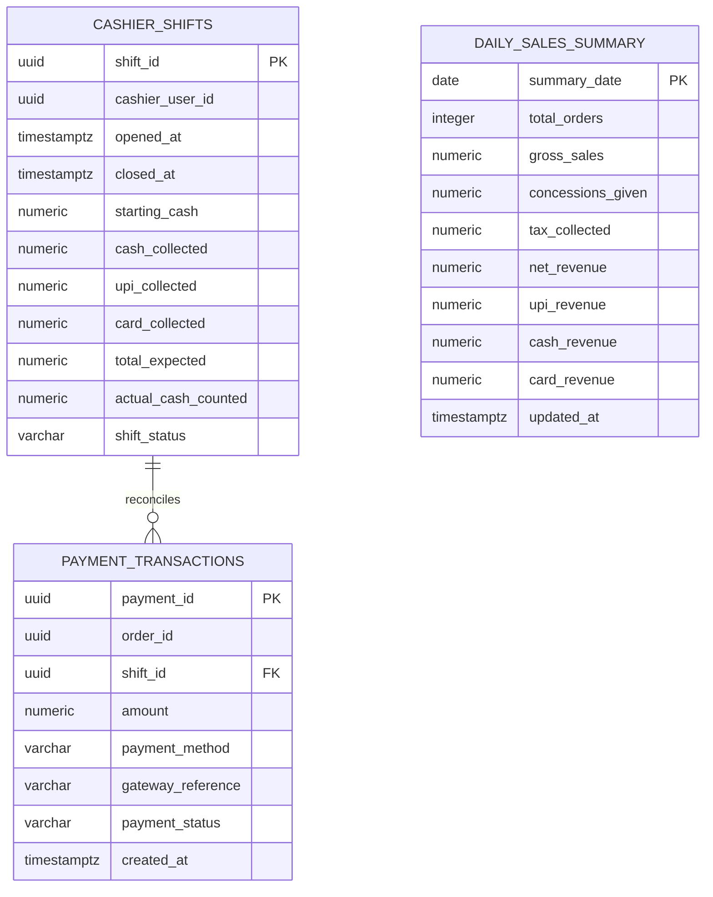

# 03. Entity-Relationship Diagrams (Per 'railcat_' Database)

---

## 1. `railcat_users` (Staff IAM)

---

## 2. `railcat_catalog` (Menu, Tariffs & Employee Concessions)

---

## 3. `railcat_orders` (Orders, Daily Queue Tokens & Kitchen Fulfillment)

---

## 4. `railcat_settlement` (Payments, Cashier Shifts & Daily Revenue)

