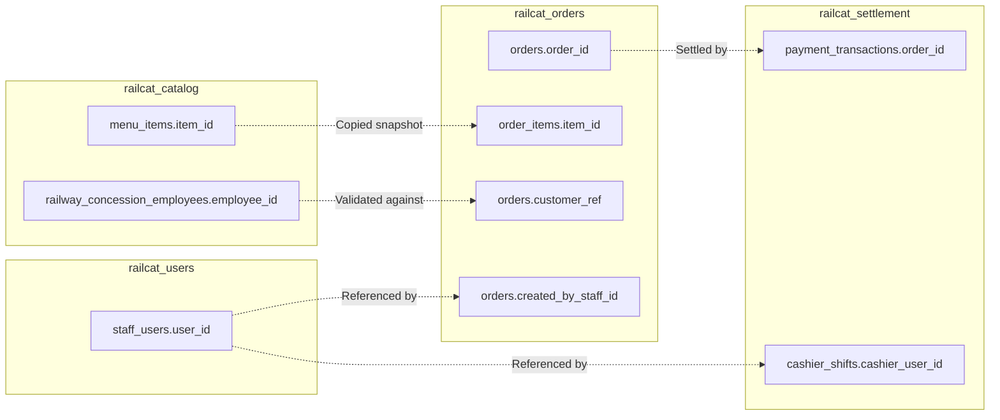
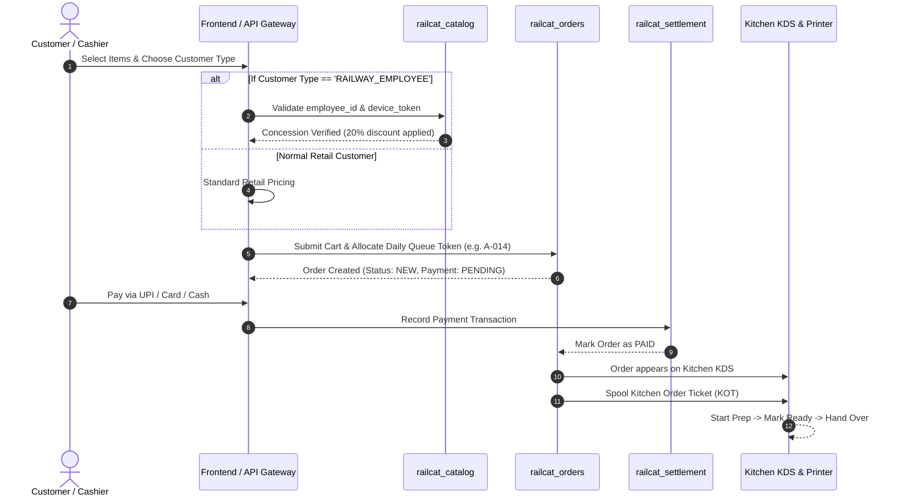

# 04. Cross-Service Relationships & Data Flow

---

## 1. Cross-Database Entity References

In compliance with the **Database-per-Service** pattern, services never use physical SQL Foreign Keys across databases. Instead, distributed entities reference each other through immutable keys.

---

## 2. Order Lifecycle & Differential Pricing Saga

